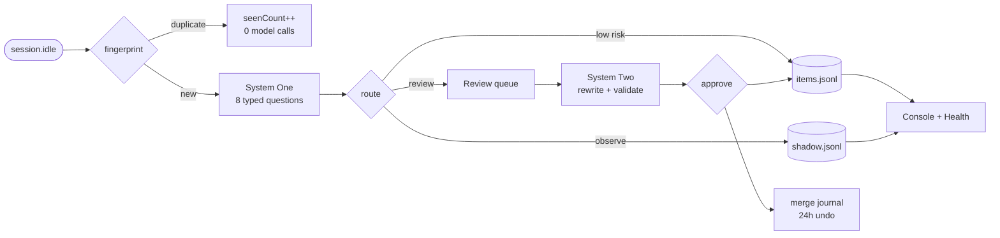

<p align="center">
  
</p>

<h1 align="center">OpenMem</h1>

<p align="center">
  <b>Memory autopilot for OpenCode.</b><br>
  Classify, dedupe, merge, approve — then keep only what earns its place.
</p>

<p align="center">
  <a href="https://github.com/blackkcold/open-mem/releases"></a>
  
  
  
</p>

OpenMem is an OpenCode plugin plus a local web console. It turns session traffic into
atomic memories and rules, writes the low-risk ones automatically, and sends everything
else to a review queue with a **prefilled merge suggestion** — so approval is one click,
not a rewrite.

It is local-only. No hosted service, no telemetry, no cloud sync.

## How it works



## Two models, one decision

| | Role | Default |
|---|---|---|
| **System One** | One request, eight typed questions: kind, safety, strict limit, duplicate, safe-to-auto, conflict, merge action, merge target. | `clef:27b-cloud` via Ollama Cloud |
| **System Two** | Rewrites candidate + target into one compliant entry. Only for merge / replace. | `glm-5.3-flash:cloud` (or `ctx.generate.text`) |

A deterministic validator gates every rewrite: linter, numeric/identifier guard,
preservation check, and a hard rule that rules never auto-merge and conflicts stay separate.
If the model fails, a deterministic composer still produces an editable suggestion.

## What you get

- **Fewer model calls** — SimHash64 dedupe runs before classification; repeats only bump `seenCount`.
- **One-click approval** — action, target, merged text, confidence, and rationale on one card.
- **Hard limits, not hopes** — 70% warn → 85% compact → 95% freeze auto-write → 100% reject.
- **Undo by default** — every apply writes a journal entry and can be reverted for 24 hours.
- **Health you can read** — score built from capacity, duplicates, conflicts, false positives, queue age, model fallback, and acceptance.

## Quick start

```bash
git clone https://github.com/blackkcold/open-mem.git
cd open-mem
npm run install:all
npm run build
npm test

npm run demo   # seeds demo data, prints a localhost URL with its token
```

The demo uses `tmp/demo-data` and never touches your OpenCode config.

### Install into OpenCode

Add the built plugin path to `~/.config/opencode/opencode.json`, then restart OpenCode:

```json
{
  "plugins": ["/absolute/path/to/open-mem/plugin"]
}
```

It starts in **shadow mode** (`shadow: true`): candidates are recorded, not written.
Review them in the console, then disable shadow when the false-positive rate looks sane.

```bash
open "http://127.0.0.1:47821/?token=$(cat ~/.config/opencode/memory/autopilot/console-token)"
```

## Safety

- Console binds `127.0.0.1`, requires a token, and stores it with mode `0600`.
- API keys are read from `OLLAMA_API_KEY` or the OpenCode auth store — never written to config or logs.
- Secrets, transient state, examples, and overlong text are rejected before any write.
- The plugin never edits `AGENTS.md`; approvals only write `AUTO_MEMORY.md` / `AUTO_RULES.md`.
- Skill approval writes to `outbox/skills/`, never the live skills directory.

## Docs

- [Architecture](docs/ARCHITECTURE.md) — both systems, routing, data layout, API.
- [Quality policy](docs/QUALITY.md) — what may be written, auto-apply gate, merge policy, caps.
- [Testing](docs/TESTING.md) — unit/API matrix, isolated real-instance results, known gaps.

## Status

`v0.2.0` · 18 test files / 65 tests · typecheck and build clean.
Validated against a real isolated OpenCode 2.1.1 instance with live System One and
System Two calls, console approval, and undo. Early-stage software: review the queue
before turning shadow mode off.

MIT licensed.
