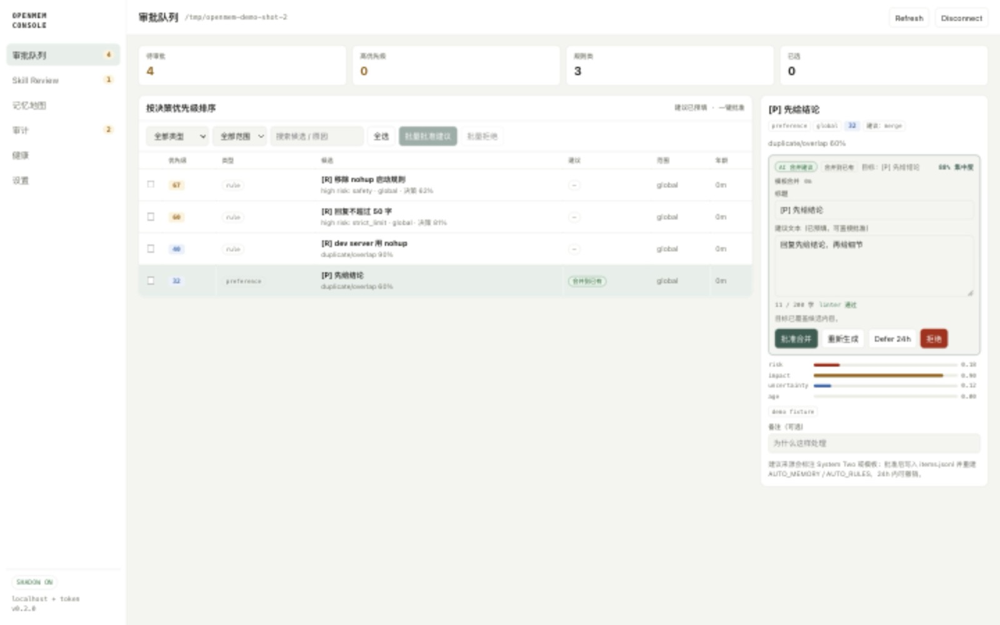

<p align="center">
  
</p>

<h1 align="center">OpenMem</h1>

<p align="center">
  <b>Memory autopilot for OpenCode.</b><br>
  Classify, dedupe, merge, approve — then keep only what earns its place.
</p>

<p align="center">
  <a href="https://github.com/blackkcold/open-mem/releases"></a>
  
  
  
</p>

OpenMem is an OpenCode plugin plus a local web console. It turns session traffic into
atomic memories and rules, writes low-risk facts/preferences automatically, and sends rules and other candidates
else to a review queue with a **prefilled merge suggestion** — so approval is one click,
not a rewrite.

Storage and console are local-only: no hosted database, telemetry, or cloud sync.
Enabled model features can send redacted content to Ollama Cloud. Shadow mode does
not disable those calls; review candidates and all rules still require human approval.

## How it works


## Two models, one decision

| | Role | Default |
|---|---|---|
| **System One** | One request, eight typed questions: kind, safety, strict limit, duplicate, safe-to-auto, conflict, merge action, merge target. | `clef:27b-cloud` via Ollama Cloud |
| **System Two** | Rewrites candidate + target into one compliant entry. Only for merge / replace. | `deepseek-v4.1-flash:1017#high` via Ollama Cloud (or `ctx.generate.text`) |

A deterministic validator gates every rewrite: linter, numeric/identifier guard,
preservation check, and a hard rule that rules never auto-merge and conflicts stay separate.
If the model fails, a deterministic composer still produces an editable suggestion.

## Session review

Turn capture only sees short user sentences that match a trigger. Decisions, debugging
lessons, and multi-step procedures rarely look like that, so a second, quieter pass runs
three minutes after a session goes quiet:

- **Incremental input** — user text plus deterministic tool digests (exit codes, error
  lines, file changes). Assistant prose is never fed back, so the model cannot reinforce
  its own wording.
- **Evidence or nothing** — every candidate must quote the exact text the model saw. A
  quote that is not a literal substring is dropped before it can reach the queue.
- **One pipeline** — review candidates become normal hooks (`origin: "session-review"`),
  reuse hook-key and SimHash dedupe, and are **never auto-written**, even when the same
  verdict would auto-apply on the turn path.
- **Cached and bounded** — 12k character budget, one model call per quiet window, zero
  System One calls, eight reviews per hour. New material resets the retry budget;
  transport failures never count toward it.

The console shows a session review card, a source filter, and the evidence quote behind
every review item.

## What you get

- **Fewer model calls** — SimHash64 dedupe runs before classification; repeats only bump `seenCount`.
- **One-click approval** — action, target, merged text, confidence, and rationale on one card.
- **Capacity recovery** — pressure warns or freezes auto-write; blocked candidates remain pending and approvals can drain a full queue.
- **Recoverable decisions** — approval/denial/promotion history can restore a candidate; merge undo has a 24h window and refuses later-edit conflicts.
- **Health you can read** — score built from capacity, duplicates, conflicts, false positives, queue age, model fallback, and acceptance.

## Quick start

```bash
git clone https://github.com/blackkcold/open-mem.git
cd open-mem
npm run install:all
npm run build
npm run verify

npm run demo   # seeds demo data, prints a localhost URL with its token
```

The demo uses `tmp/demo-data` and never touches your OpenCode config.

### Install into OpenCode

Add the built plugin path to `~/.config/opencode/opencode.json`, then restart OpenCode:

```json
{
  "plugins": ["/absolute/path/to/open-mem/plugin"]
}
```

It starts in **shadow mode** (`shadow: true`): turn candidates are observed instead of
automatically written. Session review remains enabled and can call a model; review
candidates go to the human queue, not Shadow. Disable model features explicitly if
no cloud calls are wanted. Review the evidence before disabling Shadow.

Use `/mem-console` or the `console_url` tool action for a **60-second, single-use
connection link** without the long-lived token. The browser removes the ticket
from its URL after exchange. Manual token login is also supported; a 401 screen
offers token replacement without clearing browser data.

### OpenChamber extension (optional)

The same console can live inside OpenChamber as a rail panel, a full page, and a
Work Status section.

```bash
npm run package:extension
# dist/openmem-console-extension-0.1.0.zip
```

Install that zip in **Settings → Extensions**, approve the local service, and
open **扩展页面 → OpenMem 控制台**. For development, `npm run build:extension`
and add the `extension/` folder by path instead. The full requirements,
architecture, security notes, demo-data switch, and rollback steps are in
[extension/README.md](extension/README.md).

Requires OpenChamber 2.6.0+ on web/desktop. The OpenMem server still binds
`127.0.0.1`; this extension does not enable LAN access.

## Safety

- Console binds `127.0.0.1`, requires a token, and stores it with mode `0600`.
- APIs require a Bearer header; only the SSE endpoint accepts a query token.
- Direct model endpoints are limited to HTTPS `ollama.com` or loopback Ollama;
  cloud credentials are never forwarded to loopback and redirects are refused.
- API keys are read from `OLLAMA_API_KEY` or the OpenCode auth store — never written to config or logs.
- Detected credentials are blocked before capture/model classification. Text is
  linted before durable writes; detection is defensive, not a guarantee that every
  possible private string is recognizable.
- The plugin never edits `AGENTS.md`; approvals only write `AUTO_MEMORY.md` / `AUTO_RULES.md`.
- Skill approval writes to `outbox/skills/`, never the live skills directory.

## Docs

- [Architecture](docs/ARCHITECTURE.md) — both systems, routing, data layout, API.
- [Quality policy](docs/QUALITY.md) — what may be written, auto-apply gate, merge policy, caps.
- [Testing](docs/TESTING.md) — unit/API matrix, isolated real-instance results, known gaps.

## Status

`v0.3.0` · run `npm run verify` for unit/API tests, three typechecks, builds,
extension proxy tests, and whitespace validation. [Testing](docs/TESTING.md) separates
current synthetic verification from historical isolated live-model results.
Recovery history has a preview-and-confirm cleanup policy (at least 90 days and
20 records per class); inactive sessions can be cold-archived without losing
their cursor or pinned context. Logical multi-file writes use a durable redo WAL
with startup/write-before-replay. This is not database MVCC or a guarantee against
hardware/power-loss faults. See the [hardening ledger](docs/goals/openmem-hardening/PROGRESS.md)
for verified boundaries and remaining validation gaps. No live installation is
part of this work.

MIT licensed.
